<picture>
  <source media="(prefers-color-scheme: dark)" srcset="00-header/assets/header-dark.svg"/>
  <source media="(prefers-color-scheme: light)" srcset="00-header/assets/header-light.svg"/>
  
</picture>

<picture>
  <source media="(prefers-color-scheme: dark)" srcset="04-architecture/assets/architecture-dark.svg"/>
  <source media="(prefers-color-scheme: light)" srcset="04-architecture/assets/architecture-light.svg"/>
  
</picture>

<picture>
  <source media="(prefers-color-scheme: dark)" srcset="05-metro-map/assets/metro-dark.svg"/>
  <source media="(prefers-color-scheme: light)" srcset="05-metro-map/assets/metro-light.svg"/>
  
</picture>

Each line is a part of my work, each station is a project, and the interchanges are the technologies those projects share. The dashed line is where I'm heading next.

  <a href="https://github.com/Mohamedemad27/hilal">hilal</a> ·
  <a href="https://github.com/Mohamedemad27?tab=repositories&q=bright">Smart Smile</a> ·
  <a href="https://www.linkedin.com/in/mohamed-emad-eldin-fathey/">LinkedIn</a> ·
  <a href="https://www.instagram.com/mohamedemad6648/">Instagram</a> ·
  <a href="https://www.facebook.com/mohamed.emad.972846/">Facebook</a>

